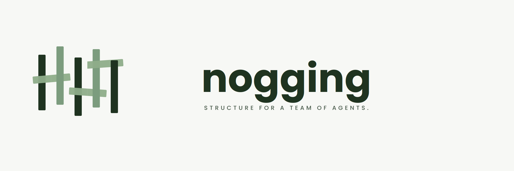
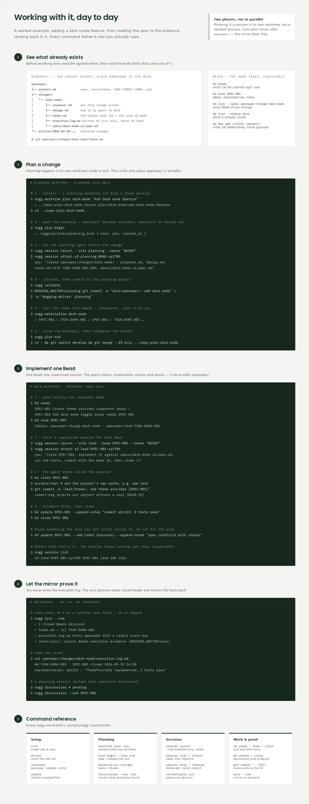
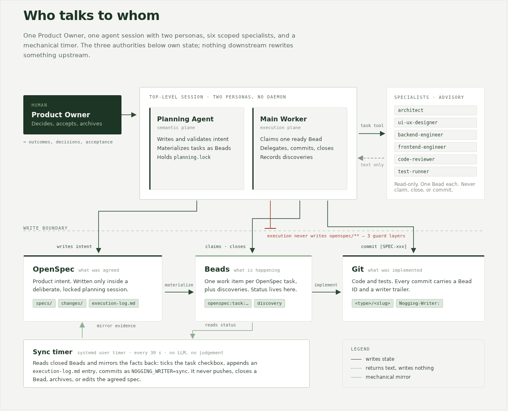

# Nogging

[](https://github.com/JoMe92/nogging/actions/workflows/nogging-validate.yml)
[](https://github.com/JoMe92/nogging/releases/latest)
[](LICENSE)
[](docs/compatibility.md)
[](docs/compatibility.md#agent-integrations)

**Structure for a team of agents.**

Nogging is a spec-driven, multi-agent workflow for AI coding agents such as Claude Code, Codex, Pi and Antigravity (experimental). A Planning Agent writes the approved plan in OpenSpec, a Lead Agent executes it as Beads tasks with Git evidence, and a sync mirrors that evidence back into the plan; the command and installed state are named `nogg`.

> Nogging is a **public release**. Read the [safety warning](#safety-warning)
> and the [security and threat model](docs/security-model.md) before you enable
> `--full-access` or background services.

## Why Nogging?

- **Problem:** several agents on one repository overwrite each other and the plan. **Solution:** one [Git worktree](docs/worktree-workflow.md) and one claimed Bead per agent.
- **Problem:** an agent "fixes" the specification to match its code. **Solution:** only a planning session writes `openspec/`; execution roles are fenced out ([boundaries](#non-negotiable-boundaries)).
- **Problem:** a run dies and the state is lost. **Solution:** claims, notes and worktree records persist, with [documented recovery](docs/failure-recovery.md).
- **Problem:** "done" is a claim, not a record. **Solution:** every closed Bead carries its commits and an evidence note that sync mirrors into OpenSpec.
- **Problem:** you use more than one agent CLI. **Solution:** the same loop for Claude Code, Codex and Pi, with Antigravity experimental.

## How it compares

Nogging builds on OpenSpec and Beads rather than competing with them.

| Alternative | What it gives you | What Nogging adds |
| --- | --- | --- |
| [spec-kit](https://github.com/github/spec-kit) | Spec-driven chat commands from `/speckit-specify` to `/speckit-implement` | Role and write boundaries, durable task ownership, Git evidence |
| [OpenSpec](https://github.com/Fission-AI/OpenSpec) alone | Per-change proposal, specs, design and `tasks.md` | Tasks become claimable Beads; evidence is mirrored back |
| [Beads](https://github.com/gastownhall/beads) alone | A Dolt-backed dependency-graph tracker for agents | The approved-spec side and the planning/execution split |
| [Claude Code subagents](https://code.claude.com/docs/en/sub-agents) | Specialists with their own context and tool allowlist | A plan, claims, worktrees and Codex/Pi support; Nogging ships six subagents itself |

Sources and detail: [docs/comparison.md](docs/comparison.md).

## Quick Guide

From nothing to a closed first Bead. Each step links to its details below.

1. Install the toolchain and Nogging on a fresh machine, pinned to a release: `curl -fsSL https://raw.githubusercontent.com/JoMe92/nogging/v3.4.0/scripts/bootstrap | bash` ([details](#install)).
2. Check that the machine is ready: `./scripts/nogg doctor` ([details](#install)).
3. Plan a change with the Planning Agent: `/plan` in Claude Code ([details](#plan-a-change)).
4. Find the work the plan created: `bd ready` ([details](#launch-a-lead)).
5. Launch a Lead Agent on one Bead: `./scripts/nogg session launch --role lead --bead <id>` ([details](#launch-a-lead)).
6. Watch it work: `./scripts/nogg session list`, then `./scripts/nogg session log <name> --follow` ([details](#watch-and-steer-sessions)).
7. Review the pull request, then mirror the evidence back: `./scripts/nogg sync --now` ([details](#close-out)).
8. Triage what the Lead discovered: `/discovery-review` ([details](#close-out)).


## Install

### Fresh machine (scripts/bootstrap)

Starting from a completely fresh machine? One pinned command provisions the
whole toolchain (Node via `nvm`, the agent CLIs, `bd`, Dolt, `git`/`tmux`/`gh`)
and then runs `init` for you; on a terminal it offers a short wizard:

```bash
curl -fsSL https://raw.githubusercontent.com/JoMe92/nogging/v3.4.0/scripts/bootstrap | bash
```

Always pin a tagged release in that URL, never `main`/`develop`. Add
`--repo <path>` to target a different (or brand-new) repository and
`--with-pi` to also install the optional Pi coding agent CLI. It is safe to
re-run: each step checks what's already installed first and only provisions
what's missing or out of range. See
[docs/installation.md](docs/installation.md#fresh-machine-scriptsbootstrap)
for the full flag reference.

### Existing repository (npx init)

Already have Node 18+ and the rest of the toolchain? Start in a new or
existing Git repository instead. The command is pinned because the initial
distribution is GitHub-only:

```bash
npx github:JoMe92/nogging#v3.4.0 init --no-systemd
./scripts/nogg doctor
./scripts/nogg validate
```

`init` creates the Beads tracker by default and prints a readiness verdict. It
does not require a website. Remove `--no-systemd` only after
reviewing the [safety warning](#safety-warning). The unscoped npm name `nogg`
belongs to another project, so this package is private and is installed from
a GitHub tag only.

`init` copies the tool files verbatim, writes an OpenSpec scaffold only where
one is missing, and merges the guard, `.gitignore`, `CLAUDE.md` and
`AGENTS.md` idempotently. It never touches `openspec/changes/`, `.beads/`, or
your `package.json`.

Refresh with `npx github:JoMe92/nogging#v3.4.0 update`; remove the managed
payload with `npx github:JoMe92/nogging#v3.4.0 remove`.

The full reference is in [docs/installation.md](docs/installation.md).

## Use it day to day

### Plan a change

In Claude Code, run `/plan`. Without it, start the supervised planner, which
gets its own worktree, stays idle until kickoff and takes the canonical planning
lock itself:

```bash
./scripts/nogg session launch --role planning --planning-id <planning-id> --description <description>
```

The manual sequence is the same flow, with both ids in kebab-case:

```bash
./scripts/nogg worktree plan <planning-id> <description>
cd <printed planning worktree path>
./scripts/nogg plan-begin
# Author the OpenSpec change: stable TASK-... IDs in tasks.md, each task a vertical slice tagged [~N loc].
./scripts/nogg validate
NOGGING_WRITER=planning git commit -m "docs(openspec): <summary>"  # commit as the planning writer before materialize
./scripts/nogg materialize <change-name>
bd dep add <blocked-id> <blocker-id>   # wire the dependencies explicitly
./scripts/nogg plan-end   # from the planning worktree, in the owning session
cd <main checkout>
./scripts/nogg worktree cleanup <record>   # last command, surviving canonical checkout
# If cleanup refuses: ./scripts/nogg session stop <name>, then
# ./scripts/nogg worktree cleanup <record> from the canonical checkout.
```

`plan-end` always precedes worktree retirement.

### Launch a Lead

`bd ready` lists the unblocked Beads and `bd show <id>` shows one. Launch a
Lead on a Bead with restricted authority:

```bash
./scripts/nogg session launch --role lead --bead <id>
```

Full access removes that restriction. Read the
[security and threat model](docs/security-model.md) first; only then add
`--full-access` on a host and repository you trust:

```bash
./scripts/nogg session launch --role lead --bead <id> --full-access
```

### Watch and steer sessions

- `./scripts/nogg session list` shows the running sessions.
- `./scripts/nogg session log <name> --follow` follows a session's output.
- `./scripts/nogg session attach <name> --read-only` looks inside without typing.
- `./scripts/nogg session watch` reports progress and stalls across sessions.
- `./scripts/nogg session send <name> "<message>"` and `session nudge <name>` steer a session.
- `./scripts/nogg session stop <name>` ends it.

An optional always-on Orchestration Agent can drive these for you; see
[Orchestration](docs/operating-model.md#orchestration). Session dispatch is on by
default: it nudges idle Leads, tracks CI and wakes the orchestrator only for decisions.
[Session wake](docs/session-wake.md) says what that costs, how to pause it and how to
switch it off.

Recurring work belongs in an approved [scheduled loop](docs/scheduled-loops.md). An optional
`.nogging/agent-routing.json` makes `session launch` without `--agent` try your agents in
order ([routing](docs/configuration.md#agent_routing_file)). Pi sessions can load optional
[Pi extensions](docs/pi-extensions.md) such as the `glm-usage` quota footer.

### Close out

The Lead commits in coherent steps, each with the `[<ID>]` token in the
subject, runs the affected suite once at the end (the full suite is CI's
job), then `bd close <id>` and
`./scripts/nogg task-done <id>`, and leaves the evidence note listing every
commit on the Bead.
You review the pull request, run `./scripts/nogg sync --now` (or rely on the
timer, enabled with `systemctl --user enable --now nogg-sync.timer`), triage
discoveries with `/discovery-review`, and archive the change when
`./scripts/nogg doctor` reports it ready. Acceptance is a signed human report.



## FAQ

**How do I run several coding agents on one repo?** Give each its own worktree and Bead; claims stop two agents taking one task. See [Worktree workflow](docs/worktree-workflow.md).

**How do I stop an AI agent from editing the plan?** Only a planning session holds the lock that opens `openspec/`; execution roles are fenced out. See [the OpenSpec write boundary](docs/architecture.md#the-openspec-write-boundary).

**Does it work with Codex?** Yes, and with Claude Code and Pi; Antigravity is experimental. See [Using Nogging with Codex](docs/using-with-codex.md).

**Does it replace an agent runtime?** No. It supervises the agent CLIs you already have. See [Vision and architecture](docs/vision-and-architecture.md).

**Which OS?** Linux. macOS and Windows are not claimed. See the [compatibility matrix](docs/compatibility.md).

More in [docs/faq.md](docs/faq.md). Questions and show-and-tell go to [GitHub Discussions](https://github.com/JoMe92/nogging/discussions) (Q&A, Show and tell).

## Safety warning

Nogging installs repository instructions and Git hooks, can run a persistent
user service, and can launch coding agents with filesystem, network, and shell
access. Protection differs across Claude Code, Codex, and Pi, so review what is
installed, protect credentials, and start with restricted authority.

Read the [security and threat model](docs/security-model.md),
[the operating model](docs/operating-model.md),
[session guidance](docs/running-work-in-sessions.md), and
[failure recovery](docs/failure-recovery.md) before you enable full access or
always-on operation.

## Project status and audience

Nogging is a **public release**. Its core workflow and Linux installation path
are exercised in CI. Keep target repositories where agents run with full access
private, and read the [safety warning](#safety-warning) before enabling
`--full-access` or background services.

Nogging is for teams and maintainers who want autonomous coding agents to work
from approved specifications with durable task ownership and auditable Git
evidence. It is not an agent runtime, hosted service, or replacement for your
existing Git repository, OpenSpec installation, or Beads tracker.

## Supported environments

- **Platform:** Linux is the supported host; Bash, Git, Python, Node.js,
  OpenSpec, Beads, and Dolt are required for the complete workflow.
- **Agents:** Claude Code, Codex, and Pi, with differing permission and sandbox
  guarantees; Antigravity is experimental.
- **Optional:** systemd for background sync, tmux or herdr for supervised
  sessions (`--no-systemd` skips the former). macOS, Windows, and other service
  managers are not claimed.

See the [compatibility policy and matrix](docs/compatibility.md) for minimum
versions, supported combinations, and evidence. `./scripts/nogg doctor` checks
the current machine against the required tool set.

## Concepts

OpenSpec owns approved product intent, Beads owns executable work, and Git owns
the implementation. A deterministic sync process mirrors execution evidence
back into OpenSpec; it never makes product decisions.

### The two phases

1. **Planning:** a Product Owner and Planning Agent create or amend an OpenSpec
   change, validate it, and materialize its stable task IDs as Beads.
2. **Execution:** a Main Worker claims ready Beads, implements and validates
   them, commits code, records discoveries, and closes the Bead.

The phases may run at the same time. Planning is session-based, not a resident
LLM process. The Main Worker and specialist agents must never edit `openspec/`.

### Roles

The **Product Owner** decides what is built; the **Planning Agent** turns that
into an OpenSpec change; the **Lead Agent** executes the Beads tasks and may
delegate to six specialists; an optional **Orchestration Agent** drives both.

### Non-negotiable boundaries

| Authority | System | May write |
| --- | --- | --- |
| Intent, requirements, decomposition | OpenSpec | Product Owner / Planning Agent during a planning session |
| Claims, dependencies, status, discoveries | Beads | Main Worker and specialists |
| Code and tests | Git worktree | Main Worker and specialists |
| Execution mirror | OpenSpec execution log | Nogging sync process only |

`open → done → archived` is the entire change lifecycle. Product acceptance is
an explicit `accepted: true` record, not another workflow state: a change is not
accepted until a signed acceptance report has been committed, produced by
running [docs/acceptance.md](docs/acceptance.md) and filled in from
[docs/acceptance-report-template.md](docs/acceptance-report-template.md). The
mechanical subset of that runbook runs unattended as the `acceptance` CI job.




Go deeper in [Vision and architecture](docs/vision-and-architecture.md).

## Documentation

Read it as a website at [jome92.github.io/nogging](https://jome92.github.io/nogging/).
Full index, grouped by concepts / using Nogging / releasing and maintaining:
[docs/README.md](docs/README.md).

Start with [Installation](docs/installation.md), the [operating model](docs/operating-model.md),
[Running work in sessions](docs/running-work-in-sessions.md) and the
[Security and threat model](docs/security-model.md). Agent guides:
[Codex](docs/using-with-codex.md), [Pi](docs/using-with-pi.md),
[Antigravity (experimental)](docs/using-with-antigravity.md). Also:
[How Nogging compares](docs/comparison.md), [FAQ](docs/faq.md),
[Architecture](docs/architecture.md), [Failure recovery](docs/failure-recovery.md),
[Acceptance runbook](docs/acceptance.md), [Contributing](CONTRIBUTING.md),
[Code of Conduct](CODE_OF_CONDUCT.md) and the [Security policy](SECURITY.md).

## Developing Nogging

Clone the repository, run `./scripts/install-hooks`, and run the suite with
`scripts/test` (also `npm test`). The CI job reference is in
[CONTRIBUTING.md](CONTRIBUTING.md#tests-and-ci); maintainers cutting a release
follow [docs/releasing.md](docs/releasing.md).

## Inspiration and related projects

Nogging is conceptually inspired by
[Gas Town](https://github.com/steveyegge/gastown), but it is an independent
implementation and is not affiliated with or endorsed by the Gas Town or Beads
maintainers. [Beads](https://github.com/gastownhall/beads) is the only Gas Town
ecosystem component currently adopted; Nogging does not include Gas Town
runtime components.
